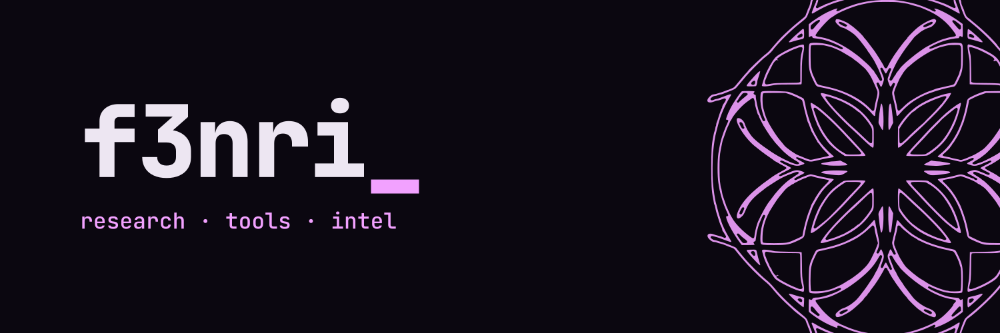

# f3nri brand kit

**f3nri** is an independent security research team building tools and publishing threat intelligence.
Pronounced "fen-ree", after Fenrir, the chain-breaking wolf of Norse mythology.
Tagline: `research · tools · intel`

---

## Contents

| Folder | What's inside |
|---|---|
| [`logo/`](logo) | The mark: SVG and PNG in three colors, favicon, original drawing |
| [`wordmark/`](wordmark) | Wordmark and mark + wordmark lockups for dark and light backgrounds |
| [`social/`](social) | Profile picture, GitHub avatar, X and LinkedIn banners, Open Graph image |
| [`colors/`](colors) | Palette image, `tokens.css`, `palette.json` |
| [`fonts/`](fonts) | Brand typefaces (TTF) and their OFL licenses |

---

## Logo

**Mark:** a single vector, used at every size.
- Default: **Neon** (`#F2A1FF`) mark on **Void** (`#0B0710`).
- On light backgrounds: the **Void** mark (`f3nri-mark-void`).
- On photos or colored backgrounds: the **Bone** mark (`f3nri-mark-bone`).
- Minimum size: 32 px. At 16 px (favicon) only the silhouette reads, which is expected.
- Clear space: keep at least 10% of the mark's width empty around it.

**Wordmark:** `f3nri_`, set in JetBrains Mono ExtraBold.
- `f3nri` in Bone on dark backgrounds, Void on light backgrounds.
- The underscore `_` is always the accent color: **Neon** on dark, **Amethyst** on light.
- Letter spacing: -0.03em.

**Lockup:** mark on the left, wordmark on the right. Primary version: `f3nri-lockup-dark-bg`.

**labs suffix (optional):** `f3nri_ labs` in JetBrains Mono Italic, Neon. A secondary version of the logo only. See `wordmark/comparison-with-without-labs.png`.

**Don't:**
- Rotate, stretch, or add shadows or glow to the mark.
- Recolor it outside the palette.
- Retype the wordmark in another typeface.
- Place the Neon mark on light backgrounds (not enough contrast).

---

## Colors

| Name | Hex | Usage |
|---|---|---|
| Void | `#0B0710` | Background |
| Obsidian | `#16101E` | Cards and surfaces |
| Seam | `#2A2135` | Lines and borders |
| Neon | `#F2A1FF` | Brand color, accent |
| Amethyst | `#7B2CBF` | Buttons, accent on light backgrounds |
| Bone | `#EDE6F2` | Primary text |
| Ash | `#9A92AC` | Secondary text |
| Signal | `#FF6B8B` | Warnings, critical findings (use sparingly) |

Contrast on Void: Bone 16.4:1, Neon 10.8:1, Ash 5.8:1, Signal 7.4:1. Bone on Amethyst: 5.8:1. All pass WCAG AA.

---

## Typography

| Role | Typeface | Weight |
|---|---|---|
| Wordmark | JetBrains Mono | ExtraBold (800) |
| Headings | Unbounded | Bold (700) |
| Body | Inter | Regular (400), SemiBold (600) |
| Code, CLI, IOCs | JetBrains Mono | Regular (400) |

All typefaces are licensed under the SIL Open Font License 1.1, free for commercial use.
For the web, load them from Google Fonts: `JetBrains Mono`, `Unbounded`, `Inter`.

---

## Social media

| File | Use |
|---|---|
| `social/profile-400x400.png` | Profile picture on X, LinkedIn, Instagram, Telegram, Discord |
| `social/github-avatar-500x500.png` | GitHub organization avatar |
| `social/x-banner-1500x500.png` | X header |
| `social/linkedin-banner-1584x396.png` | LinkedIn company page cover (left side kept clear for the profile picture) |
| `social/og-image-1200x630.png` | Link preview image for the website |
| `logo/favicon.ico` | Browser tab icon |

---

## Links

- Web: [f3nri.com](https://f3nri.com)
- GitHub: [github.com/f3nrilabs](https://github.com/f3nrilabs)
- X: [x.com/f3nrilabs](https://x.com/f3nrilabs)
- Instagram: [instagram.com/f3nrilabs](https://instagram.com/f3nrilabs)
